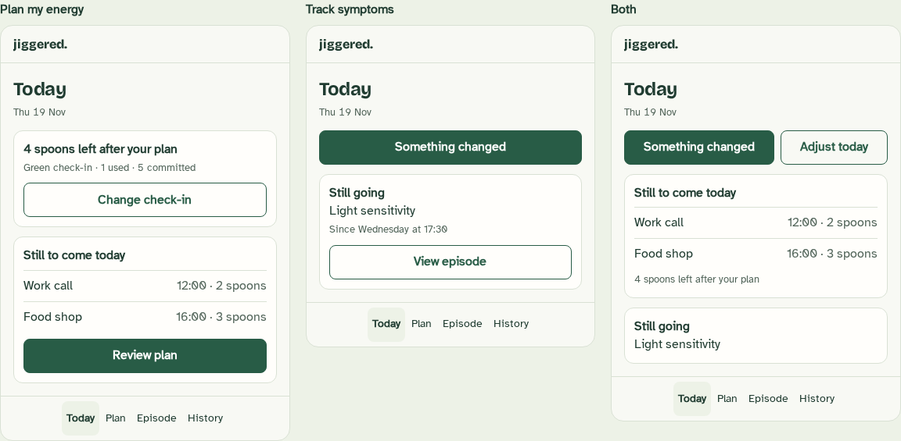

# Energy and symptoms Stage 1 baseline

The [implementation handoff](https://github.com/eyupio/jiggered/blob/docs/energy-and-symptom-handoff/docs/energy-and-symptom-handoff.md) defines the stages. It was read from the head of [PR #199](https://github.com/eyupio/jiggered/pull/199) at `141e901ec165b3e8584c24d594a2d02afbaaac0f`. This stage branches from `main` at `32559e15d4d65618320d13dec9ae6fa11aaa9c09` as `docs/energy-and-symptom-stage-1`. The Stage 1 PR identifies the reviewed head. Stage 1 contributes design evidence and test data. Production behaviour belongs to the implementation stages.

## Baseline journey

| Surface | Fresh Account                                                                                                                                                      | Existing planner Account                                                                                                                                    | Gap addressed in the handoff                                                                                                                     |
| ------- | ------------------------------------------------------------------------------------------------------------------------------------------------------------------ | ----------------------------------------------------------------------------------------------------------------------------------------------------------- | ------------------------------------------------------------------------------------------------------------------------------------------------ |
| Today   | Setup checklist, Check-in and starter Activities. The Episode tab is already reachable before energy setup.                                                        | Check-in, energy breakdown, ongoing Episodes and a remaining Plan with Review plan and Done.                                                                | Give capture a direct first tap. In Both, bring that tap and Adjust today above the remaining Plan, with the next commitment visible.            |
| Plan    | Plan your day opens the entry editor.                                                                                                                              | The date view and calendar show reservations. The list provides Edit and Remove. On the calendar, Left and Right move the focused timed entry across dates. | Offer an explicit Move action and destination preview for touch and keyboard. Keep and swap should work from Plan with no Episode involved.      |
| Episode | Onset defaults to the current local time. A new Episode needs a Symptom or note, then a duration or Still going and an explicit Save. Unsubmitted text is a Draft. | Still going appears on Today and Episode with ending controls. History can reopen an Episode for editing and return to History.                             | Save a timestamp from Today before requesting any detail, and distinguish Queued, Saved and refused Changes.                                     |
| History | The Period, calendar and Browse records are available with no recorded Days or Episodes.                                                                           | Browse records shows Days and Episodes. An Episode is indexed by its onset date. CSV and printable Summary use the Period and filters.                      | Show a deferred capture without inventing an onset. Over time, record explicit symptom-free observations and keep unknown dates visible as gaps. |

With the fictional Account’s short custom lists, the existing Shared defaults Offer appears above all four views. On the phone it pushes Today’s Plan below the first screen. Test that state when adding the direct capture action.

The Plan keyboard move issues two writes, adding to the destination and then removing from the source. That is enough to demonstrate the baseline journey. Interrupted and retried cross-date saves, destination previews and optional links belong to Stage 3. Keeping the call in this scenario means leaving its reservation in place. **Done** has a different meaning and creates an actual Entry.

## Reproduce the fictional week

`test/fixtures/energy-and-symptom-week.json` contains fixed dates, a Europe/London clock, a `baseline` shaped like an Account JSON Export and an `expected` scenario for the later stages. The browser test restores the baseline into a disposable server, walks both Account states, then uses the existing calendar keyboard action to move the shop. The fixture can be loaded from a clean checkout with the standard Contributor setup.

```sh
npm ci --prefix test
npm --prefix test run browser:install
node test/browser-fictional-week.cjs
```

For a manual walkthrough, extract the existing record map and load it through **Account → Data → Restore** on a disposable Account. Choose **Replace matching records** so the fixture’s settings replace the automatically seeded ones. Use the fixture clock in automated runs. In an ordinary browser use History’s date fields and the relevant dates in Plan to see the November records.

```sh
node -p 'JSON.stringify(require("./test/fixtures/energy-and-symptom-week.json").baseline)' > /tmp/jiggered-fictional-week.json
```

| Fictional fact                                                                 | Baseline representation                                                                                                                                         | Expected next outcome                                                                                                                  |
| ------------------------------------------------------------------------------ | --------------------------------------------------------------------------------------------------------------------------------------------------------------- | -------------------------------------------------------------------------------------------------------------------------------------- |
| Monday 16 Nov, blank                                                           | No Day, Plan or Episode starts on this date.                                                                                                                    | Remains unknown.                                                                                                                       |
| Tuesday 17 Nov, explicitly symptom-free                                        | No structured observation. The baseline also has no record for this date.                                                                                       | Show a recorded symptom-free day separately from Monday.                                                                               |
| Wednesday 18 Nov, light sensitivity starts at 17:30 and is ongoing on Thursday | One ordinary `e-…` record with local `when`, zone and offset, named Symptom, notes and `Still going`.                                                           | Preserve the Episode. Individual days observed and a change from usual need their own semantics.                                       |
| Thursday 19 Nov, notices a change at 11:00 and later estimates 10:30           | Existing `when` is onset. It cannot distinguish capture time from the later estimate.                                                                           | One record with immutable capture time and optional estimate, available after offline replay.                                          |
| Thursday to Friday, moves food shop and keeps the 12:00 work call              | Plans are separate `p-…` documents. Thursday breakfast is already a Day Entry costing one spoon. The keyboard move relocates the shop; the call stays reserved. | Stage 3 provides an explicit move with a preview and optional link, preserving one reservation and actual usage across retry and Undo. |

The Thursday example begins with 10 spoons of Allowance, one used and five committed. Moving the three-spoon shop leaves two committed on Thursday and increases Friday’s committed cost from one to four. The fixture includes no real health records.

## Save, replay and sharing

| Path                      | Existing source and behaviour                                                                                                                                                                                                                                                                                                                                                                       |
| ------------------------- | --------------------------------------------------------------------------------------------------------------------------------------------------------------------------------------------------------------------------------------------------------------------------------------------------------------------------------------------------------------------------------------------------- |
| Save a Day or Plan        | [Today](../web/today.js) and [Plan](../web/planner.js) dispatch operations. [Planner rules](../web/planner-model.js) combine reservations and actual Entries through `plannedEntryId`. A Plan reservation stays out of Day spending until Done.                                                                                                                                                     |
| Save or finish an Episode | [Episode editor](../web/episodes.js) validates onset and duration. New Episodes use a generated `e-…` ID and `replace`; edits use `patch` with the original fields for conflict detection. Ending an ongoing Episode uses the same record. The Draft and queued Change have separate lifecycles.                                                                                                    |
| Queue and replay          | [`sync.js`](../web/sync.js) applies operations optimistically, persists the account-scoped snapshot and outbox via [`device.js`](../web/device.js), and drains using revision preconditions. A 409 gives the current server copy. [`model.js`](../web/model.js) decides whether a Change can replay or must become a Held change. The writer lock and restore pause are already in place.           |
| History and export        | [`history.js`](../web/history.js) shares the History selection with preview and filtered CSV. [`history-model.js`](../web/history-model.js) derives observations and counts from [readable Days and Episodes](../web/model.js). Account JSON Export instead uses [`/api/export`](../docs.go) after flushing the browser store. A Device copy exports queued or Held changes and Drafts for support. |
| Restore                   | [Account Data](../web/account.js) previews and downloads the pre-Restore Account Export before committing. [`restore.go`](../restore.go) binds confirmation to the preview, Account and current data. [`validate.go`](../validate.go) runs on both regular writes and Restore. Record names and additional JSON fields can survive a round trip through the opaque store.                           |

## Today layout studies

[Open the three mobile studies](energy-and-symptom-stage-1-layouts.html) in a browser from the checkout. They reuse the existing typography, colours, labels and Plan order. The studies illustrate controls and placement. The following interactions are design proposals.



| Preference         | Phone hierarchy and first tap                                                                                                                                                         | Return path                                                                                                                                                                                       |
| ------------------ | ------------------------------------------------------------------------------------------------------------------------------------------------------------------------------------- | ------------------------------------------------------------------------------------------------------------------------------------------------------------------------------------------------- |
| **Plan my energy** | Check-in and the energy breakdown first, then Still to come today. Tap **Review plan** to open today’s Plan directly. Check-in remains available in place.                            | Return to Today and the remaining commitments. Show the revised reservation and Projected balance after a change.                                                                                 |
| **Track symptoms** | **Something changed** first, then any ongoing Episode. The capture action is available before any energy setup. A fresh diary shows a short empty state in place of the ongoing item. | Keep focus on Today with the capture time, status, **Undo** and **Add detail**. Use the Episode editor for details and return to the same Today location.                                         |
| **Both**           | **Something changed** and **Adjust today** immediately above Still to come today. Work call is the first row. At larger text sizes the actions stack in the same order.               | Capture shows status in place while keeping the plan visible. Adjust today opens today’s Plan and returns to the same commitment list. Linking a capture to the adjustment is an explicit choice. |

Impeccable shape used the established Operate design and the two jobs in the handoff. The design priority was capturing a change without choosing symptoms while tired, while still seeing the work call on the way back. Preserve the familiar planner landing for existing Accounts and keep the preference editable when Stage 4 ships. Production controls should use native buttons with visible focus, restore focus on return and announce local and server status without shifting the primary actions away. Allow date/entry selection for a move so dragging is optional.

## Verification and continuation

- `make check` passed with Go 1.27.4, including the race suite and 154 JavaScript tests. The Stage 1 PR records the full browser suite result.
- The focused scenario passed on the real Go/SQLite app in a 1440×1000 light desktop view and a 390×844 dark emulated touch view. It drove all four tabs with keyboard and touch respectively, reopened the legacy Episode from History, returned to History, verified Restore preview left data intact, checked the exact JSON Export and moved the shop with the keyboard. History fit the viewport without horizontal page overflow at both widths.
- The static studies were rendered separately in Chromium 159 in light and dark at 320, 390 and 1440 CSS pixels wide with normal and 200% root text size. At normal text the Both actions are at least 44 px high. At 200% the compact spacing keeps both actions and the full first commitment within the first 653 px of the 320 px mock and 588 px of the 390 px mock. Both themes passed the measured action and muted-text contrast pairs. The source detector’s remaining font warning points to the bundled Atkinson Hyperlegible face already listed in DESIGN.md. Interactive focus, accessible status updates and browser-native text zoom for the proposed UI remain implementation checks.

- The existing regression entry points are `test/browser-today.cjs`, `test/browser-planner.cjs`, `test/browser-calendar.cjs`, `test/browser-history.cjs` and `test/browser.cjs`. The last covers offline save, Held changes and stale Restore preview. `test/model.test.mjs`, `test/sync.test.mjs`, `test/device.test.mjs`, `test/history.test.mjs` and `restore_test.go` cover the affected model, replay and round-trip boundaries. Start there for Stage 2.
- The smallest next change is a real **Something changed** action on Today, backed by one replay-safe queued creation under a stable Episode ID. Keep the captured timestamp separate from the optional estimated onset. Make an undetailed capture discoverable and editable in History before it has an onset. Reuse the current dispatch, status, Undo and Episode editor paths, and verify legacy read, finish, Export and Restore. Leave the preference picker and Plan changes for their assigned stages.
- Codex implemented and reviewed the fixture using Ponytail and Ponytail Review at `ebd8654c2c627f721eb8f9c0d1bd4090a29f9e10`. The Claude Opus runner was unavailable, so Codex prepared the proposed layouts and ran independent design and technical reviews with Impeccable at `2fc5e1459efbbf06d92c7306517c286bf12490cf` (engine `0.1.31`). The Stage 1 walkthrough is synthetic and uses browser emulation. Physical-device and participant sessions are outstanding.

### Paste into a new Codex session

```text
Work in eyupio/jiggered as the Codex lead for Stage 2. Read
docs/energy-and-symptom-handoff.md in full. If PR #199 is still open, read it
from its head branch docs/energy-and-symptom-handoff. Read AGENTS.md,
CONTRIBUTING.md, GLOSSARY.md, and the relevant ADRs. Check open and merged PRs
before editing. Read docs/energy-and-symptom-stage-1.md and reuse
test/fixtures/energy-and-symptom-week.json plus test/browser-fictional-week.cjs
from the Stage 1 PR. Resume an existing Stage 2 branch if there is one.
Use the reviewed Stage 1 changes as your prerequisite and record their commit.

Load Ponytail for coding and review and Impeccable for UX and web UI. Start
with the Today capture action and the existing Episode, History, sync, device,
Export and Restore paths. One tap creates one editable record with a stable
ID and the exact capture timestamp even offline. Show Queued, Saved and
failure distinctly. Support Undo and later detail, including approximate
onset and change from usual. Keep capture time distinct from the estimate.
Preserve legacy Episode editing and ending. Follow the handoff's scope;
planner changes and the Today preference picker have their own stages.

Prove the Stage 2 acceptance: tap offline, close, reopen and reconnect. There
is exactly one editable capture. Exercise retry, Undo, and a competing edit
from another device. Verify History, Export and Restore with a new capture
and with a legacy Episode. Run make check and make browser. Record the actual
phone, desktop, accessibility and verification results, including blockers.

Open or update the Stage 2 PR with the results, base and head commits,
remaining items, and a paste-ready Codex Stage 3 prompt pointing to the same
handoff file. Check existing Stage 3 work before proposing a new branch.
```
